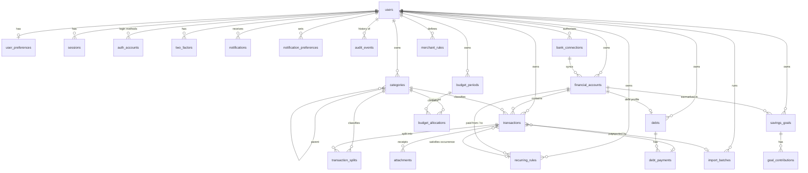

# Data model

Source of truth: `src/server/db/schema.ts`. Migrations: `drizzle/` (generated with
`npm run db:generate`, applied with `npm run db:migrate` or automatically for PGlite).

## Conventions

* **Ownership**: every user-owned row has `user_id → users.id ON DELETE CASCADE`. Services
  always filter by the authenticated user id and load referenced rows through `owned*`
  helpers, so another user’s id can never be used to read or attach data. Deleting a user
  removes all of their financial data in one statement.
* **Ids**: random UUIDs (`gen_random_uuid()`); auth tables use Better Auth’s random text ids.
* **Money**: `bigint` minor units. **Dates**: `date` (calendar day). **Instants**: `timestamptz`.
* **Timestamps**: `created_at`, `updated_at` (`$onUpdate`) on mutable tables; `updated_at`
  doubles as an optimistic-concurrency token for transaction edits.
* **Constraints** (DB-enforced, not just app-enforced): account type/currency/mask format,
  transaction kind/status, transfer ⇔ `transfer_group_id`, split ⇒ no parent category,
  non-zero split/contribution amounts, unique (account, fingerprint) and (account,
  external_id) for idempotent imports, unique active category name per user, month format,
  APR range, due-day range, positive goal targets.
* **Indexes**: (user, date), (account, date), (user, category), (user, merchant_key),
  transfer group, recurring rule, plus FK lookup indexes.

## Archival and deletion semantics

| Entity | Archive | Delete |
|---|---|---|
| Account | Hidden from totals and pickers; history stays in reports and exports | Only when it has no transactions besides the opening balance |
| Category | Hidden from pickers and future budgets; past transactions, splits and allocations keep pointing at it; name freed for reuse | Not offered (would rewrite history) |
| Goal | Status `archived`/`completed`; contributions kept | Deletes the goal and its contributions; balances unaffected |
| Recurring rule | Status `paused`/`ended` | Deletes the schedule; linked transactions are unlinked (`SET NULL`) |
| Debt profile | — | Removes rate/payment details; the liability account remains |
| Transaction | — | Hard delete (both transfer legs together) with an audit snapshot; reconciled rows are protected |
| Import batch | — | “Undo” deletes the rows it created (except reconciled), keeps the batch record |
| User | — | Cascades to every table above |
